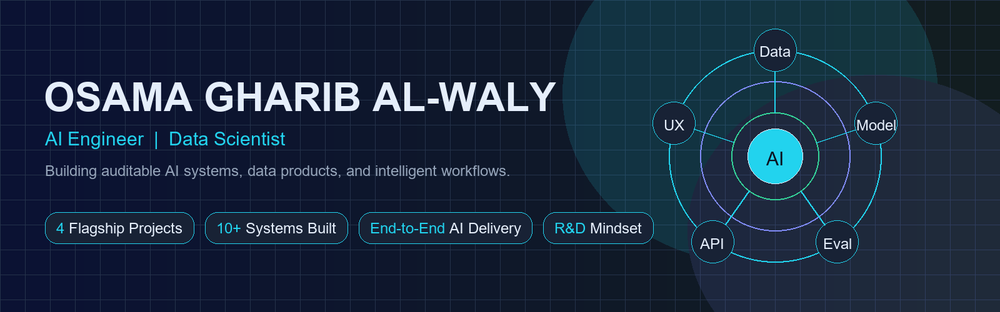
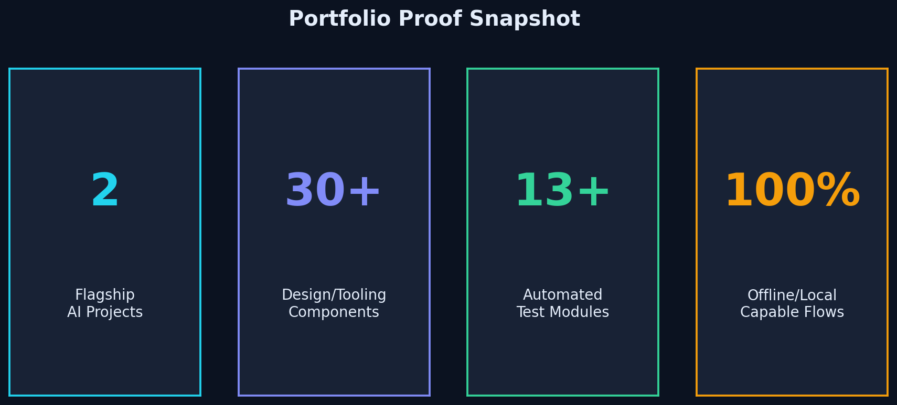
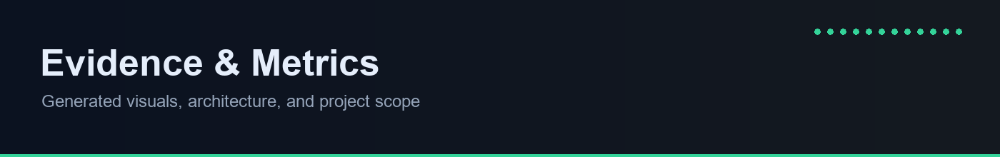
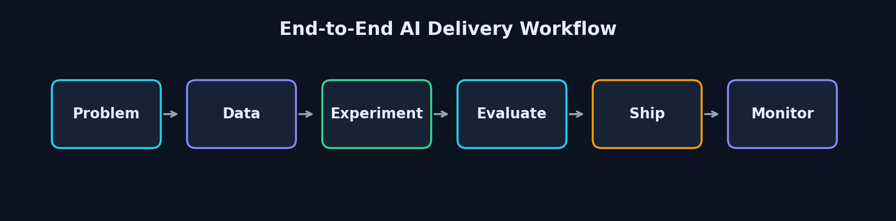
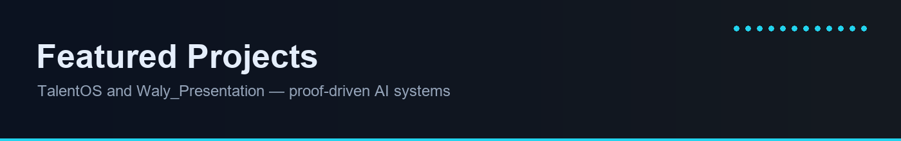
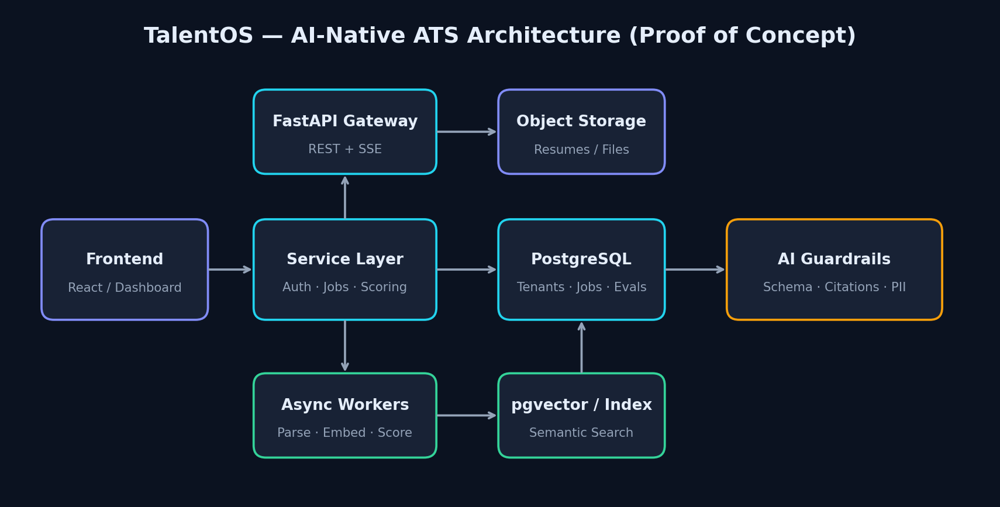
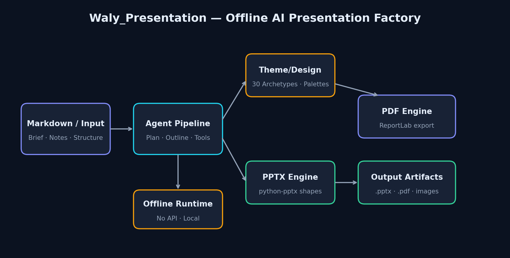
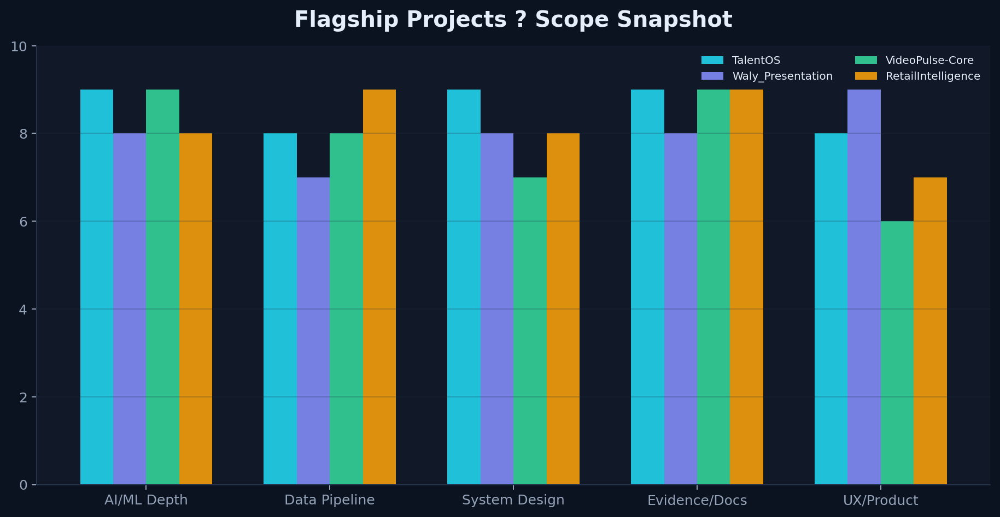
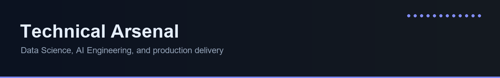
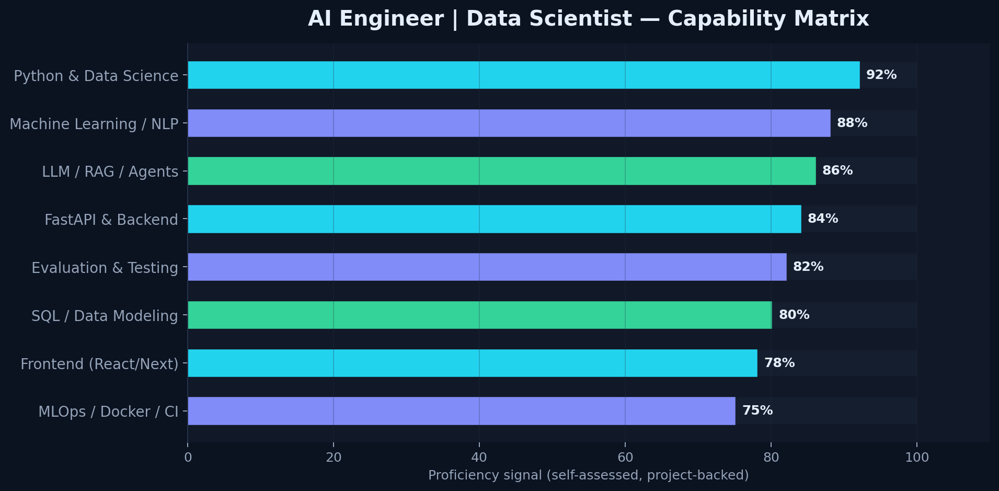

<p align="center">
  
</p>

<p align="center">
  <a href="https://github.com/OsamaGharibElwaly"></a>
  <a href="https://osama-gharib-elwaly.vercel.app/"></a>
  <a href="https://www.linkedin.com/in/osama-alwaly"></a>
  <a href="mailto:osamagharib04@gmail.com"></a>
</p>

<p align="center">
  
  
  
  
</p>

---

## Profile

I build **AI systems with a data-science backbone**: clear problem framing, structured data, evaluated models, and production-minded delivery. My work sits at the intersection of **AI Engineering, Data Science, and software systems** — turning experiments into auditable, usable products.

<p align="center">
  
</p>

## Evidence & Delivery

<p align="center">
  
</p>

| Signal | What it means |
|---|---|
| **2 flagship POCs** | Deep, architecture-documented projects instead of broad shallow demos |
| **End-to-end workflow** | Problem → Data → Experiment → Evaluate → Ship → Monitor |
| **Generated visuals** | Charts/diagrams are reproducibly generated via `scripts/generate_visuals.py` |
| **Docs + proof** | Each project has architecture, scope, and evidence in `docs/projects/` |

<p align="center">
  
</p>

## Featured Projects

<p align="center">
  
</p>

> Live screenshots captured from running projects (8s settle) and enhanced with PIL framing for portfolio proof.

<table>
<tr>
<td width="50%" valign="top">

### 1) TalentOS — AI-Native ATS (POC)

**AI Engineering + Data Science + Backend Systems**

An auditable hiring intelligence proof of concept: structured resume extraction, rubric-weighted scoring, citation verification, hybrid semantic search, and interview copilots.

<p align="center">
  
</p>

**Proof highlights**
- Schema-validated extraction & typed contracts
- Evidence-backed scoring with citation guardrails
- Hybrid SQL + vector talent search
- AI ops telemetry: latency, cost, quality

**Stack:** Python, FastAPI, PostgreSQL, pgvector, Redis/Celery, Pydantic, Next.js, Docker

📄 [Project proof](docs/projects/talentos.md)

</td>
<td width="50%" valign="top">

### 2) Waly_Presentation — Offline AI Presentation Factory (POC)

**AI Workflow Automation + Data-to-Artifact + Product Engineering**

An offline agent-style pipeline that converts structured Markdown into styled PPTX/PDF artifacts with catalog-driven design systems and deterministic rendering.

<p align="center">
  
</p>

**Proof highlights**
- Offline-first, no cloud dependency for core flow
- 30 design archetypes with theme/palette catalogs
- Agent-style planning, parsing, layout routing
- Deterministic PPTX/PDF artifact generation

**Stack:** Python, PyQt6, python-pptx, ReportLab, Pydantic, JSON catalogs, Matplotlib, Pillow

📄 [Project proof](docs/projects/waly-presentation.md)

</td>
</tr>
</table>

<p align="center">
  
</p>

## Technical Arsenal

<p align="center">
  
</p>

<p align="center">
  
</p>

| Domain | Tools / Capabilities |
|---|---|
| **AI / ML** | Python, Scikit-learn, PyTorch, Transformers, NLP, embeddings, LLM/RAG, agent workflows |
| **Data Science** | Pandas, NumPy, SQL, statistical reasoning, evaluation, experiment design, data visualization |
| **Backend / APIs** | FastAPI, REST APIs, Pydantic, async workers, auth/RBAC patterns, observability |
| **Product / Frontend** | Next.js, React, TypeScript, Tailwind, accessible UI, data-driven dashboards |
| **Delivery** | Docker, Git/GitHub, CI/CD mindset, testing, reproducible docs, artifact generation |

## Repository Structure

```text
.
├── docs/                       # Project proof, architecture notes, generated visuals
│   ├── images/                 # Matplotlib/PIL generated charts & banners
│   └── projects/               # TalentOS & Waly_Presentation proof docs
├── public/assets/generated/    # Same generated visuals for the Next.js site
├── scripts/generate_visuals.py # Reproducible visual generation
├── src/app/                    # Next.js portfolio app
└── README.md
```

## Regenerate Visual Proof

```bash
python scripts/generate_visuals.py
```

## Contact

<p align="center">
  
</p>

- **Email:** [osamagharib04@gmail.com](mailto:osamagharib04@gmail.com)
- **Portfolio:** [osama-gharib-elwaly.vercel.app](https://osama-gharib-elwaly.vercel.app/)
- **LinkedIn:** [linkedin.com/in/osama-alwaly](https://www.linkedin.com/in/osama-alwaly)
- **GitHub:** [github.com/OsamaGharibElwaly](https://github.com/OsamaGharibElwaly)