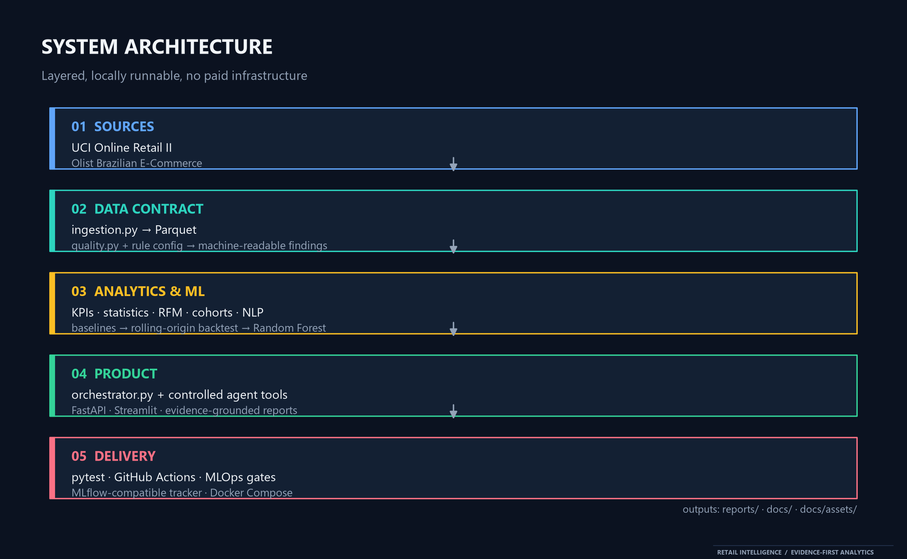
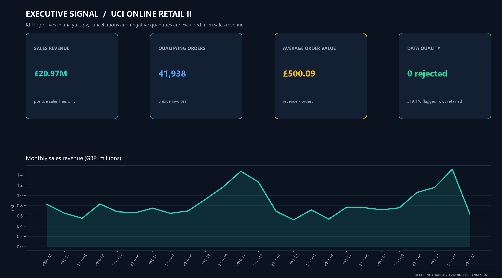
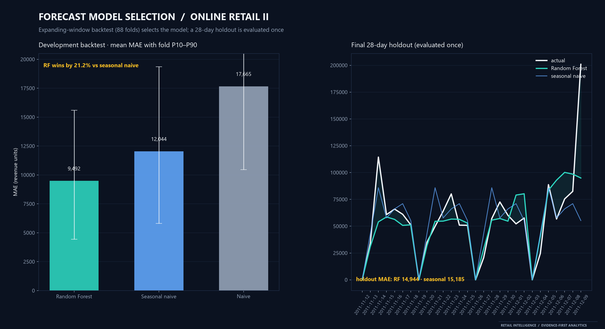
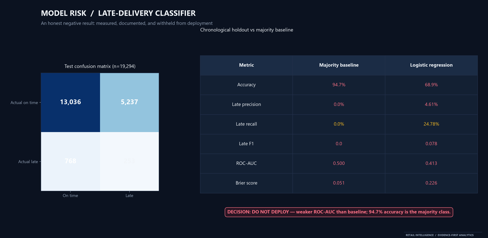
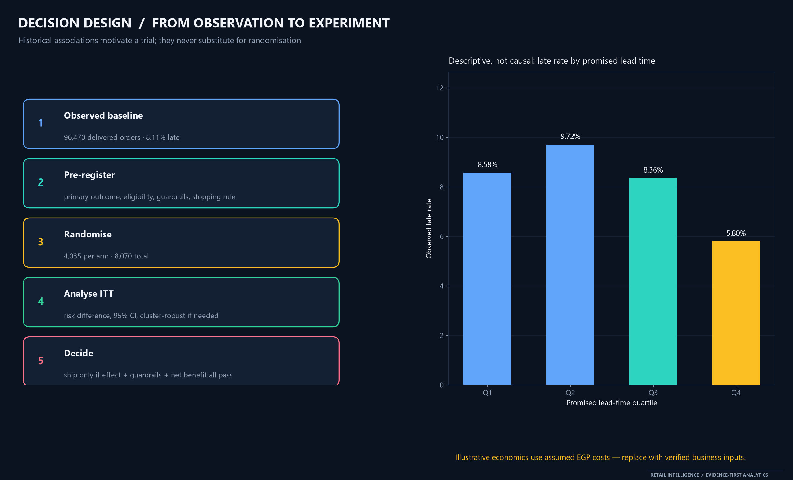
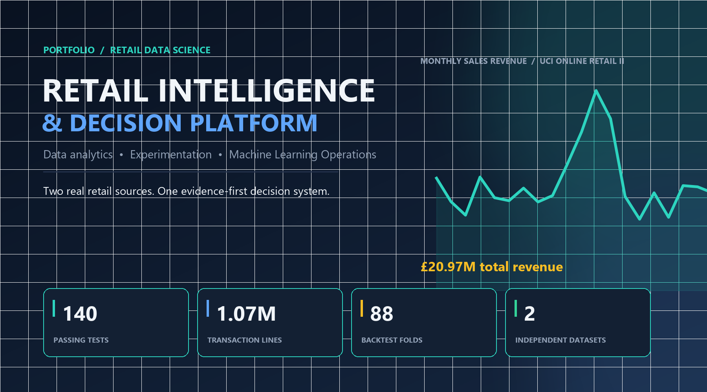

# RetailIntelligence

**Category:** Data Science + Analytics / MLOps  
**Status:** Proof of Concept / Portfolio System  
**Repository:** [OsamaGharibElwaly/RetailIntelligence](https://github.com/OsamaGharibElwaly/RetailIntelligence)

## Overview

Retail Intelligence & Decision Platform is an evidence-first analytics and MLOps system built on two real retail datasets (UCI Online Retail II and Olist Brazilian E-Commerce). It moves from raw ingestion and data-quality contracts to analytics, forecasting, operational modeling, experiment design, API/dashboard surfaces, and CI-enforced promotion gates. The project emphasizes traceability, leakage controls, and honest reporting — including a documented negative model result.

## Architecture

## Live Evidence (from project assets)

| Executive KPIs | Forecast selection |
|---|---|
|  |  |

| Model risk (honest negative result) | Experiment design |
|---|---|
|  |  |

| Product hero |
|---|
|  |

## Highlights

- **Evidence-first data contracts:** schema validation, manifests, typed analytical views, no silent corruption.
- **Leakage-safe forecasting:** expanding-window backtests and one-time 28-day holdout; modest gains reported honestly.
- **Honest model risk:** late-delivery classifier marked "do not deploy" after poor ROC-AUC/F1 vs baseline.
- **Experiment design:** pre-registered A/B protocol, power analysis, ITT plan, guardrails, and decision rule.
- **Productized delivery:** orchestrator, controlled agent tools, FastAPI, Streamlit dashboard, 140 tests, CI gates.

## Tech Stack

Python, Pandas, DuckDB, scikit-learn, FastAPI, Streamlit, Pytest, GitHub Actions, Parquet, Matplotlib.