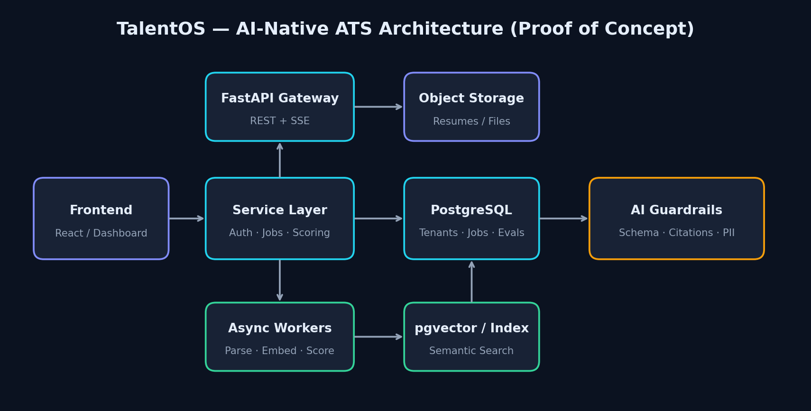

# TalentOS — AI-Native ATS & Talent Intelligence (Proof of Concept)

> Flagship project #1. Scope: AI engineering + data science + backend systems.

## Problem

Recruiting teams lose signal in resume noise: manual triage, brittle keyword filters, and opaque scoring. TalentOS treats hiring as an auditable data pipeline.

## Proof of Concept Scope

- **Multi-tenant foundation**: org-scoped entities, RBAC, job/rubric model.
- **Ingestion pipeline**: PDF/DOCX upload, deterministic parsing, structured extraction, dedup.
- **Evidence-based scoring**: rubric-weighted evaluation with citation verification guardrails.
- **Interview copilot**: tailored questions and calibrated scorecards.
- **Talent search**: hybrid SQL + vector retrieval for semantic candidate discovery.
- **Observability**: latency, token/cost, schema validity, human override telemetry.

## Architecture

## Data & AI Flow

1. Ingest resume/job data.
2. Parse and normalize into structured schema.
3. Embed chunks and retrieve relevant evidence.
4. Score against weighted rubric with citations.
5. Expose results in API/UI with audit trail.

## Engineering Signals

- Typed contracts (Pydantic/schema validation).
- Deterministic citation verification before persisting claims.
- Async processing for batch ingestion.
- Evaluation mindset: golden sets, schema validity, groundedness checks.

## Stack

Python, FastAPI, PostgreSQL, pgvector, Redis/Celery-style workers, Pydantic, Next.js/React, Docker.