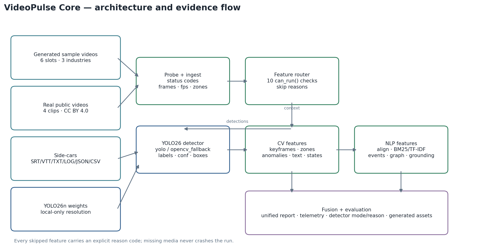
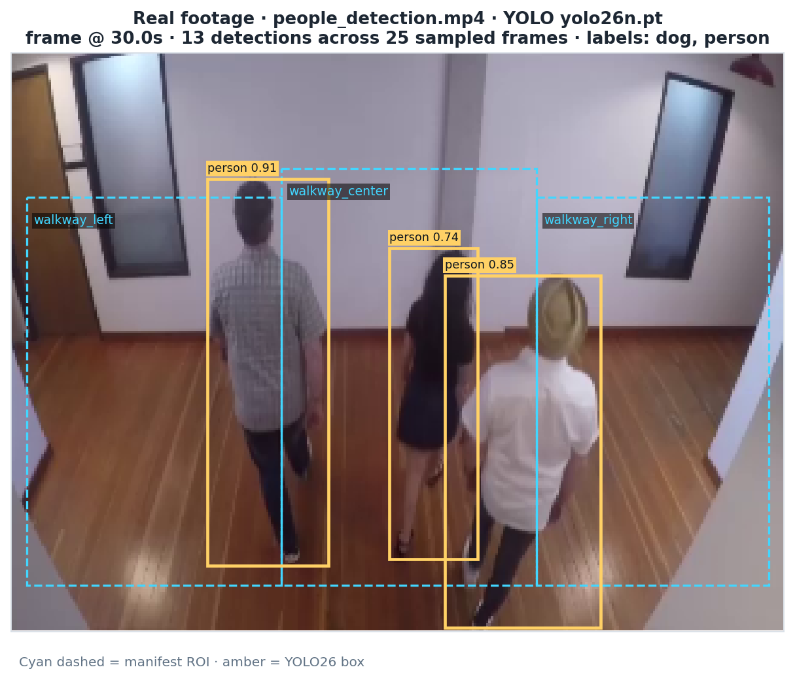
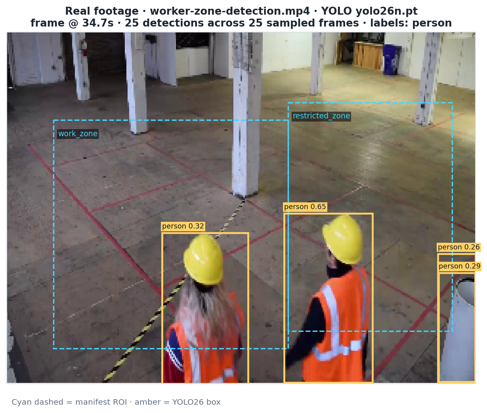
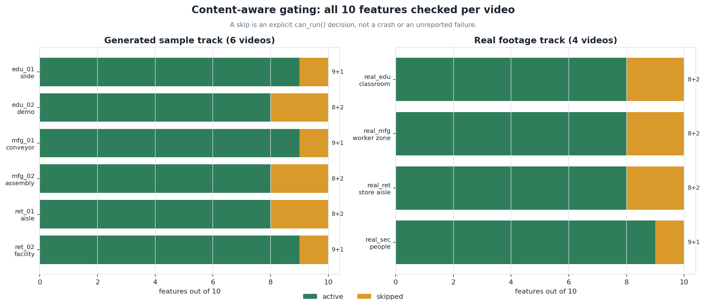
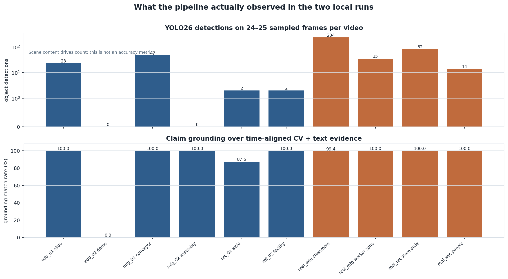
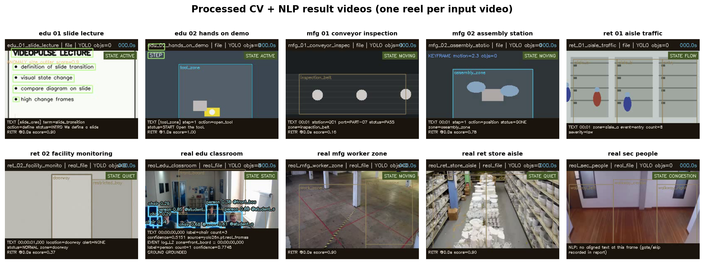

# VideoPulse-Core

**Category:** Computer Vision + NLP  
**Status:** Proof of Concept / Research-Engineering Project  
**Repository:** [OsamaGharibElwaly/VideoPulse-Core](https://github.com/OsamaGharibElwaly/VideoPulse-Core)

## Overview

VideoPulse Core is a gated CV + NLP video analytics system that processes video as a sequence of auditable evidence. It samples frames, detects objects with Ultralytics YOLO26, runs content-aware CV features, aligns timestamped text/log data, and fuses outputs into retrieval, entity-graph, and claim-grounding results. Each feature has an explicit `can_run(context) -> (bool, reason)` gate, so skipped features are reported decisions, not silent failures.

## Architecture

## Live Evidence (captured from repo artifacts)

| YOLO detections on real footage | Worker-zone detection & ROI |
|---|---|
|  |  |

| Feature coverage | Detection and grounding |
|---|---|
|  |  |

| Result video contact sheet |
|---|
|  |

## Highlights

- **10 gated features:** 5 CV + 5 NLP, each with explicit preconditions and skip reasons.
- **Real + generated tracks:** deterministic generated clips and real public footage with attribution.
- **Auditable outputs:** machine-readable reports, annotated result reels, telemetry, and provenance.
- **Reliability:** fail-soft detector path, no implicit downloads, no fabricated metrics.
- **Verification:** 41 unit tests, 10 full reports, and generated visual evidence.

## Tech Stack

Python, OpenCV, NumPy, Ultralytics YOLO26, scikit-learn, BM25/TF-IDF, NetworkX, Pandas, Matplotlib, Pillow.