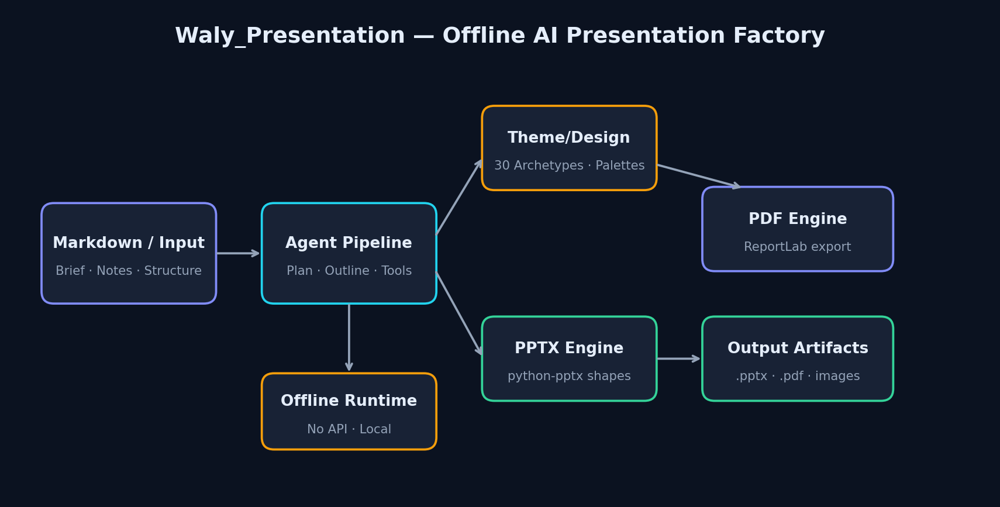

# Waly_Presentation — Offline AI Presentation Factory (Proof of Concept)

> Flagship project #2. Scope: AI workflow automation + data-driven content generation + desktop product engineering.

## Problem

Creating polished presentations from structured content is slow, repetitive, and often cloud-dependent. Waly_Presentation turns Markdown/input into styled PPTX/PDF artifacts locally.

## Proof of Concept Scope

- **Offline-first pipeline**: no API dependency for core generation flow.
- **Markdown-to-slide agent flow**: parse structure, plan slides, route layouts.
- **Design system engine**: 30 visual archetypes, palette catalogs, theme registry.
- **Rendering engines**: python-pptx geometric slide builder and ReportLab PDF export.
- **Studio UI**: PyQt6 interface for theme selection, swatches, markdown input, export.
- **Artifact outputs**: generated `.pptx`, `.pdf`, and image assets.

## Architecture

## Evidence

- Local repository includes builder engines, agent pipeline, catalog JSONs, tests, and generated output artifacts in `out/`.
- Design catalog covers 30 archetypes across modern, editorial, corporate, and creative systems.
- Export workflow produces presentation artifacts from structured markdown.

## Data / AI Angle

While generation is deterministic/offline, the system models an AI-agent workflow: planning, tool routing, structured transformation, and evaluated output artifacts. It demonstrates practical AI product engineering: controllable pipelines, reproducible outputs, and user-facing delivery.

## Stack

Python, PyQt6, python-pptx, ReportLab, Pydantic/dataclasses, JSON catalogs, local file pipeline.